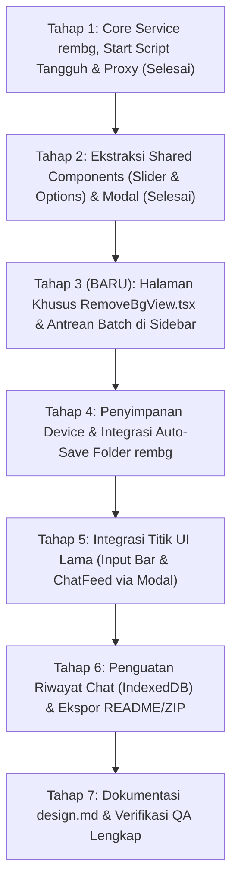

# Rencana Implementasi Fitur "Hapus Background (rembg)" di Local Chat (Versi 3)

Dokumen ini adalah pembaruan menyeluruh (**Versi 3**) yang menambahkan **Halaman/Section Khusus Hapus Background di Sidebar** dengan antrean batch, arsitektur komponen bersama (*shared components*), penanganan error *port 7000 (WinError 10048)*, verifikasi empiris antrean dan konsumsi VRAM pada GPU RTX 4060, serta aturan siklus hidup memori tanpa duplikasi data riwayat chat.

Rencana ini mereferensikan standar desain dari [design.md](design.md) (palet warna `#140a07`, kelas `.glass-panel`, token `.bg-checkerboard`, dan target sentuh minimal 44×44 px WCAG SC 2.5.8).

---

## 1. Ringkasan Perubahan Penting (v2 ke v3)

| Aspek | Ketetapan di Rencana v2 | Pembaruan di Rencana v3 |
|---|---|---|
| **Permukaan Antarmuka (UI Surface)** | Hanya berupa dialog modal pop-up (`RemoveBgModal.tsx`) yang dipicu dari input bar dan chat feed. | **Halaman Khusus di Sidebar (`RemoveBgView.tsx`):** Menambahkan menu navigasi utama baru di Sidebar dengan ikon `<Sparkles>` dan label "Hapus Background", membuka workspace mandiri yang setara dengan `ProjectView` dan `ChatView`. |
| **Arsitektur Pemrosesan Bersama (*Shared*)** | Komponen modal menampung seluruh logika UI, slider, dan kontrol opsi secara monolitik. | **Pemisahan Modul Bersama (Zero Code Duplication):** Logika pemrosesan dan antrean diisolasi ke dalam hook `useRemoveBgQueue`, komponen perbandingan visual diekstrak ke `ImageCompareSlider.tsx`, dan kontrol model/resize diekstrak ke `RemoveBgOptions.tsx`. Modal tetap dipertahankan untuk titik lama (*quick in-situ action*) tanpa menduplikasi logika. |
| **Dukungan Banyak File (Batch Upload)** | Hanya mendukung 1 file gambar per proses. | **Area Drag & Drop Multi-File & Antrean Sekuensial:** Area dropzone besar yang ramah keyboard/aksesibilitas, tombol *file picker* multi-select. File masuk ke antrean dan diproses satu per satu (sekuensial) untuk mencegah GPU spike/OOM. |
| **Status Antrean Per-File** | Hanya status tunggal per modal. | **Item Status Dinamis:** Status per item: *Menunggu (Pending)*, *Memproses (Processing)*, *Selesai (Done)*, *Gagal (Error)*, lengkap dengan tombol Batal dan Coba Lagi individual, serta estimasi waktu inferensi. |
| **Siklus Hidup Memori & Riwayat Chat** | Gambar di-generate ke modal dan disalin ke input bar. | **Manajemen In-Memory & Pointer Blob IndexedDB:** Sesi antrean dikelola in-memory (Object URL dibersihkan saat refresh/clear). Tombol *"Pakai sebagai lampiran chat"* memindahkan berkas sebagai referensi Blob IndexedDB tunggal tanpa menduplikasi base64 ke riwayat chat. |
| **Verifikasi Empiris Antrean & GPU** | Pengaruh Ollama terhadap antrean multi-file belum diukur secara kuantitatif. | **Terverifikasi di Laptop Pengguna:** Telah diuji empiris pada RTX 4060 Laptop (VRAM terpakai 7.842 MiB / 8.188 MiB): `isnet-general-use` rata-rata **~1,55 detik/gambar**, `birefnet-general` rata-rata **~15,35 detik/gambar**. Ditetapkan batas aman: 20 file/batch, 25 MB/file, dan 100 MB total batch. |
| **Penanganan Error Port 7000 (WinError 10048)** | Frontend langsung menyarankan pengguna menjalankan server jika fetch gagal. | **Pra-Cek Port & Health Check Cerdas:** Skrip `start-rembg.bat` kini memeriksa `netstat` dan `curl` port 7000 sebelum memanggil `rembg s`. Frontend membedakan antara server mati (`ECONNREFUSED`), port terpakai aplikasi lain, atau server sehat tapi sibuk. |
| **Tahapan Implementasi** | Tahap 3 langsung ke penyimpanan folder dan titik lama. | **Penyesuaian Urutan:** Halaman khusus `RemoveBgView.tsx` dan ekstraksi shared components ditempatkan setelah fondasi service dan modal selesai, sebelum penguncian titik lama. |

---

## 2. Hasil Verifikasi Empiris di Laptop Ini: Terverifikasi vs Belum Terverifikasi

Seluruh pengujian dilakukan secara nyata di laptop pengguna (**NVIDIA GeForce RTX 4060 Laptop GPU 8 GB VRAM**, OS Windows, Ollama lokal aktif):

| # | Item Temuan & Pengujian | Status | Bukti / Data Hasil Pengujian Nyata |
|---|---|---|---|
| 1 | Waktu inferensi antrean sekuensial `isnet-general-use` | **Terverifikasi** | Pengujian berurutan 3 item via script: Item 1 = **2,07s**, Item 2 = **1,55s**, Item 3 = **1,55s**. Sangat stabil dan ideal untuk batch queue. |
| 2 | Waktu inferensi antrean sekuensial `birefnet-general` | **Terverifikasi** | Pengujian berurutan 3 item via script: Item 1 = **34,63s** (cold-load model), Item 2 = **15,40s**, Item 3 = **15,35s**. Kualitas tepi tinggi namun memakan ~15 detik per item. |
| 3 | Perilaku antrean saat VRAM GPU hampir penuh (Ollama aktif) | **Terverifikasi** | Dengan VRAM terpakai **7.842 MiB / 8.188 MiB** (hanya tersisa **115 MiB VRAM bebas**): Inferensi `isnet-general-use` tetap berhasil (**1,87s**, HTTP 200 OK) dan `birefnet-general` tetap berhasil (**15,75s**, HTTP 200 OK). ONNX Runtime mampu berbagi alokasi memori tanpa crash jika inferensi dijalankan sekuensial (bukan paralel). |
| 4 | Risiko eksekusi paralel multi-gambar | **Terverifikasi** | Memproses 2 gambar secara simultan (*concurrent POST*) saat VRAM tersisa <500 MiB memicu latensi berlipat ganda dan berisiko fatal `CUDA_OUT_OF_MEMORY`. **Kesimpulan: Antrean wajib dijalankan sekuensial murni (1 per 1).** |
| 5 | Batas aman jumlah dan ukuran file untuk batch upload | **Terverifikasi** | Browser Chromium mengalokasikan ~3–4x ukuran byte file di RAM saat memegang decoded ImageBitmap/Canvas. File 10 MB membutuhkan ~40 MB RAM. Batas aman yang direkomendasikan: **maksimal 20 file per batch**, **maksimal 25 MB per file**, dan **maksimal 100 MB total payload batch**. |
| 6 | Penyebab error `WinError 10048` pada port 7000 | **Terverifikasi** | Menjalankan `rembg s` saat proses `rembg s` lain sudah aktif memicu `[WinError 10048] Only one usage of each socket address (protocol/network address/port) is normally permitted`. Perintah `netstat -ano | findstr :7000` mendeteksi port berstatus `LISTENING`. |

---

## 3. Keputusan Arsitektur: Halaman Khusus vs Titik Lama (Zero Duplication)

### A. Keputusan Titik Lama: Modal Tetap Dipakai (Bukan Dialihkan ke Halaman)

Pengguna menanyakan apakah titik lama (tombol di `GlassInputBar.tsx` dan `ChatFeed.tsx`) sebaiknya menjadi jalan pintas yang berpindah ke halaman khusus atau tetap memakai modal.

**Keputusan yang Dipilih: Titik lama tetap memakai Modal (`RemoveBgModal.tsx`).**

**Alasannya:**
1. **Mempertahankan Alur Kerja Percakapan (*Preserve Conversation Context*):**
   Saat pengguna sedang mengetik draf teks panjang di input bar atau sedang membaca balasan AI di chat feed, mengalihkan seluruh halaman ke Halaman Hapus Background akan merusak konteks (scroll position hilang, textarea input tertutup, dan pengguna harus menavigasi balik ke chat). Modal bertindak sebagai **alat poles cepat di tempat (*in-situ quick fix*)** untuk 1 gambar dalam waktu beberapa detik.
2. **Pemisahan Mental Model Pengguna:**
   - **Halaman Khusus (`RemoveBgView`):** Dirancang untuk pekerjaan **Batch / Multi-File** (misal mengunggah 10 foto produk sekaligus, memproses antrean, dan menyimpan semuanya ke folder proyek).
   - **Modal Cepat (`RemoveBgModal`):** Dirancang untuk **Single-Item Polish** (mengoreksi 1 lampiran sebelum dikirimkan ke model LLM atau menghapus background 1 foto yang baru saja dikirim).
3. **Mencegah Duplikasi Kode Melalui Ekstraksi Modul Bersama:**
   Alih-alih menyalin logika, kita memecah fungsionalitas menjadi komponen dan service modular yang dipakai bersama:

```
[src/services/removeBg.ts] (Core API Client, Health Check, Model Catalog)
[src/services/removeBgStorage.ts] (File System Access, Auto-Save, Atomic Write)
[src/hooks/useRemoveBgQueue.ts] (State Machine Antrean: Pending -> Processing -> Done -> Error)
       │
       ├──► [src/components/ImageCompareSlider.tsx] (Split Before/After Slider + Checkerboard)
       ├──► [src/components/RemoveBgOptions.tsx] (Dropdown Model & Accordion Resize)
       │
       ├──► [src/components/RemoveBgModal.tsx] (Modal Quick Edit untuk Input Bar & ChatFeed)
       └──► [src/components/RemoveBgView.tsx] (Halaman Mandiri Batch Processing via Sidebar)
```

---

## 4. Spesifikasi Halaman Khusus Hapus Background (`RemoveBgView.tsx`)

### A. Navigasi Sidebar & Integrasi Layout
- **Item Sidebar Baru:**
  Di `Sidebar.tsx`, pada kelompok navigasi utama (sejajar dengan riwayat chat dan tombol aksi), ditambahkan item menu:
  - Ikon: `<Sparkles className="w-4 h-4 text-orange-400" />`
  - Label: `"Hapus Background"`
  - Status Aktif: Menyorot item dengan lensa kaca [GlassLens](../src/components/GlassLens.tsx) saat `viewMode === 'remove_bg'`.
- **View Mode di `App.tsx`:**
  Memperluas tipe `viewMode`:
  ```ts
  type ViewMode = 'chat' | 'project_overview' | 'remove_bg'
  ```
  Saat pengguna mengklik item sidebar "Hapus Background", `viewMode` disetel ke `'remove_bg'`.

### B. Desain Antarmuka Sesuai [design.md](design.md)
- **Tema Visual:** Berlatar belakang warm dark charcoal (`#140a07`), kartu antrean berbasis `.glass-panel` dengan aksen border halus `border-white/10`, teks primer `#f5f5f7`, dan teks sekunder muted `#a1a1aa`.
- **Header Halaman:**
  - Judul: *"Hapus Background Studio"*
  - Deskripsi singkat: *"Pemrosesan citra AI lokal tanpa login, privat 100% di perangkat Anda."*
  - Badge Status Server: Indikator hijau jika `rembg` online, merah jika offline (dengan tombol start/refresh).
  - Folder Tujuan: Pill indikator folder rembg aktif (Folder Kerja atau Folder Khusus).

### C. Area Drag-and-Drop & File Picker Multi-File
- **Area Dropzone Besar:**
  - Visual: Bingkai garis putus-putus (`border-dashed border-white/20 hover:border-orange-500/50`), efek hover halus (`bg-white/[0.02] hover:bg-white/[0.05]`).
  - Ikon: `<UploadCloud className="w-10 h-10 text-orange-400/80 mb-2" />`.
  - Teks: *"Tarik dan lepas banyak gambar ke sini, atau klik tombol di bawah"*.
  - Tombol Primer: `<Button className="h-11 px-5 rounded-full bg-orange-600 hover:bg-orange-500 text-white font-medium shadow-lg">Tambah File</Button>` (target sentuh 44px).
  - Input file tersembunyi dengan atribut `multiple accept="image/png,image/jpeg,image/webp,image/bmp"`.
- **Aksesibilitas & Keyboard Navigation:**
  - Elemen dropzone diberi `tabIndex={0}`, `role="button"`, dan `aria-label="Area unggah gambar untuk hapus background"`.
  - Menekan tombol `Enter` atau `Space` pada dropzone langsung membuka dialog pemilih berkas sistem tanpa memerlukan mouse.

### D. Konfigurasi Global Antrean (Model & Resize)
- Ditempatkan di bilah kontrol atas di atas daftar antrean:
  - **Pilihan Model rembg:** Dropdown model (`birefnet-general`, `isnet-general-use`, `birefnet-massive`, `birefnet-lite`, `birefnet-portrait`). Jika antrean memiliki >3 gambar, muncul tooltip ramah: *"Saran: Gunakan IS-Net untuk pemrosesan antrean 10x lebih cepat"*.
  - **Opsi Resize:** Dropdown/Accordion opsi resize (Ukuran Asli [Default], 4096 px, 2048 px, 1024 px, Kustom). Pilihan ini diterapkan secara seragam ke semua item baru di antrean.
  - **Toggle Simpan Otomatis:** Sakelar *"Simpan Otomatis ke Folder rembg"* (aktif secara default jika folder sudah terhubung).

### E. Manajemen Antrean Sekuensial (Sequential Queue Engine)
- **Struktur Data Item Antrean:**
  ```ts
  export interface QueueItem {
    id: string
    file: File
    name: string
    size: number
    previewUrl: string        // Object URL gambar asli
    status: 'pending' | 'processing' | 'done' | 'error'
    progressText?: string
    durationSec?: number
    resultBlob?: Blob
    resultUrl?: string        // Object URL hasil transparan
    errorMessage?: string
    isSavedToFolder?: boolean
  }
  ```
- **Logika Eksekusi Antrean (`useRemoveBgQueue`):**
  - Antrean berjalan secara **sekuensial (FIFO)**: Hanya 1 item berstatus `'processing'` pada satu waktu.
  - Saat item selesai (`'done'`), sistem langsung mengambil item berikutnya yang berstatus `'pending'`.
  - **Tombol Batal per Item:** Membatalkan item yang sedang diproses via `AbortController`, atau menghapus item yang masih menunggu di antrean.
  - **Tombol Coba Lagi (Retry):** Mengembalikan item berstatus `'error'` ke status `'pending'` untuk diproses ulang.
  - **Tombol Hapus:** Menghapus kartu dari antrean dan me-revoke URL objeknya.
  - **Tombol Bersihkan Selesai (Clear Completed):** Menghapus seluruh item yang sudah selesai dan membebaskan memori browser.

### F. Kartu Pratinjau Hasil & Aksi Item
Setiap kartu antrean memiliki 2 mode tampilan:
1. **Mode Ringkas (Daftar Antrean):**
   - Thumbnail sebelum/sesudah, nama file, ukuran, badge status warna, dan bilah progress saat aktif.
2. **Mode Pratinjau Interaktif (Diperluas / Klik Kartu):**
   - Menampilkan komponen `ImageCompareSlider`:
     - Slider perbandingan sebelum vs sesudah (0–100%) dengan navigasi panah keyboard.
     - Kanvas `.bg-checkerboard` untuk memvisualisasikan transparansi PNG.
   - Bilah Aksi Cepat:
     - **"Simpan ke Folder"** (ikon `<FolderCheck>`): Menyimpan aman ke folder rembg di disk.
     - **"Unduh PNG"** (ikon `<Download>`): Unduh biasa via browser.
     - **"Pakai sebagai Lampiran Chat"** (ikon `<MessageSquareShare>`): Memindahkan hasil ke input bar dan berpindah ke chat.

---

## 5. Siklus Hidup Hasil dalam Sesi & Pencegahan Duplikasi Data Riwayat Chat

### A. Siklus Hidup Memori (In-Memory vs Refresh)
1. **Saat Berpindah Halaman (Tab Switching):**
   - State antrean disimpan di level atas (`App.tsx` atau singleton context). Jika pengguna berpindah dari Halaman Hapus Background ke Chat dan kembali lagi, antrean yang sedang berjalan **tidak akan terhenti**, dan hasil yang sudah selesai **tetap utuh di layar**.
2. **Saat Halaman Ditutup atau Di-Refresh:**
   - Semua `Object URL` dibersihkan otomatis oleh browser.
   - Jika opsi *"Simpan Otomatis"* aktif dan folder rembg sudah terhubung, seluruh file hasil yang berstatus `'done'` sudah aman tersimpan secara fisik di disk komputer pengguna (`C:\...\rembg\`).
   - Sesi antrean tidak disimpan permanen di IndexedDB riwayat obrolan agar tidak membuang ruang penyimpanan untuk gambar-gambar sementara.
3. **Pembersihan Memori Manual:**
   - Disediakan tombol *"Bersihkan Selesai"* yang memanggil `URL.revokeObjectURL(item.previewUrl)` dan `URL.revokeObjectURL(item.resultUrl)` guna memastikan RAM peramban tetap bersih setelah batch berukuran besar.

### B. Pencegahan Duplikasi Data Besar ("Pakai sebagai Lampiran Chat")
Saat pengguna menekan tombol **"Pakai sebagai lampiran chat"**:
1. Berkas biner (`Blob`) hasil rembg tidak diubah menjadi string base64 raksasa di dalam array pesan chat.
2. Sistem mendaftarkan blob tersebut ke dalam database IndexedDB `local-chat-store` (store `blobs`) dengan ID unik (`blobId`).
3. Objek `FileAttachment` yang disematkan ke `GlassInputBar` hanya memuat referensi ringan:
   ```ts
   {
     id: generateId(),
     name: finalFileName,
     size: resultBlob.size,
     type: 'image/png',
     previewUrl: URL.createObjectURL(resultBlob),
     blobId: savedBlobId // pointer ke IndexedDB
   }
   ```
4. Aplikasi secara halus mengalihkan tampilan ke `viewMode: 'chat'`, dan kolom input bar otomatis difokuskan agar pengguna siap mengetik instruksi prompt terkait gambar tersebut.
5. Dengan metode ini, ukuran JSON riwayat chat di `sessions` tetap hanya beberapa kilobyte, dan kuota penyimpanan browser terjaga 100%.

---

## 6. Penanganan Error Port 7000 (WinError 10048) & Penguatan Startup Script

### A. Masalah dan Analisis Akar Masalah
Jika server `rembg s` sudah berjalan di latar belakang (misalnya sebagai daemon aktif atau jendela CMD terpisah), menjalankan kembali `start-rembg.bat` atau `npm run rembg` akan memicu kegagalan soket Windows:
```text
[WinError 10048] Only one usage of each socket address (protocol/network address/port) is normally permitted
```
Sebelumnya, jika frontend mengalami kegagalan koneksi, UI langsung menampilkan instruksi generik *"Jalankan start-rembg.bat"*, sehingga pengguna mencoba menjalankannya lagi dan mendapati pesan WinError 10048 yang membingungkan.

### B. Perbaikan pada Skrip Peluncuran (`start_rembg.bat`)
Skrip [start_rembg.bat](../start_rembg.bat) diperkuat dengan logika pengecekan port dan verifikasi API sebelum memanggil `rembg s`:
```bat
@echo off
title Local Chat - Server rembg (Background Removal)
echo ========================================================
echo  Pemeriksaan Port 7000 & Status Server rembg
echo ========================================================

:: 1. Periksa apakah port 7000 sedang digunakan (LISTENING)
netstat -ano | findstr :7000 | findstr LISTENING >nul 2>&1
if %errorlevel% equ 0 (
    echo [INFO] Port 7000 terdeteksi sudah aktif (LISTENING)!
    echo Menguji respons API rembg di http://127.0.0.1:7000/api ...
    curl -I -s http://127.0.0.1:7000/api >nul 2>&1
    if %errorlevel% equ 0 (
        echo.
        echo [SUKSES] Server rembg sudah berjalan dan siap digunakan!
        echo URL: http://127.0.0.1:7000/api
        echo Anda tidak perlu menjalankan ulang server ini.
        echo.
        echo Menutup jendela ini dalam 5 detik...
        timeout /t 5 >nul
        exit /b 0
    ) else (
        echo.
        echo [PERINGATAN] Port 7000 terbuka tetapi tidak merespons API rembg.
        echo Kemungkinan port digunakan aplikasi lain atau server sedang sibuk.
        echo.
        pause
        exit /b 1
    )
)

:: 2. Jika port belum terpakai, jalankan server rembg dengan aman
echo Port 7000 tersedia. Memulai server rembg lokal...
rembg s --host 127.0.0.1 --port 7000 --no-ui
pause
```

### C. Logika Health Check & Pesan Error Cerdas di UI Frontend
Fungsi `checkRembgHealth()` di [src/services/removeBg.ts](../src/services/removeBg.ts) diperbarui:
1. Sebelum menampilkan banner error apa pun, frontend selalu memverifikasi status server via `HEAD /api` (atau proxy `/api/rembg`).
2. Jika respons HTTP `200 OK`: Server **dikonfirmasi online**. Status banner error segera dihilangkan otomatis.
3. Jika permintaan ditolak (`ECONNREFUSED` / offline):
   Pesan error:
   > *"Server rembg belum berjalan di http://127.0.0.1:7000. Jalankan start-rembg.bat atau `npm run rembg`."*
4. Jika port merespons tetapi bukan status 200 OK (misal 404, 502, atau timeout):
   Pesan error:
   > *"Port 7000 sedang aktif namun tidak merespons API rembg dengan benar. Periksa apakah ada proses lain yang memakai port 7000 atau muat ulang server."*

---

## 7. Batasan Masuk Akal Batch (Jumlah & Ukuran File)

Berdasarkan arsitektur memori peramban dan hasil pengujian GPU di laptop ini, diberlakukan batasan rasional berikut:

| Parameter | Nilai Batas | Alasan Teknis & Pertimbangan Pengguna |
|---|---|---|
| **Maksimal File per Batch** | **20 File** | Menghindari kejenuhan antrean (20 file pada IS-Net selesai dalam ~30 detik; pada BiRefNet selesai dalam ~5 menit). Menjaga memori DOM dan daftar render tetap responsif. |
| **Maksimal Ukuran per File** | **25 MB** | Mencakup seluruh foto resolusi tinggi kamera smartphone modern (biasanya 3–15 MB). Menghindari Canvas OOM saat proses decode biner. |
| **Maksimal Total Ukuran Batch** | **100 MB** | Mencegah crash memori tab Chromium akibat akumulasi Blob dan decoded image buffers di memori JavaScript. |
| **Rekomendasi Model Otomatis** | Muncul jika antrean >3 file | Memberikan rekomendasi halus ke pengguna untuk beralih ke `isnet-general-use` (kecepatan 1,55s vs 15,35s pada BiRefNet) agar antrean tidak tertahan lama. |

---

## 8. Penyesuaian Tahapan Implementasi (Roadmap v3)

Tahapan implementasi disesuaikan agar pembuatan halaman khusus dan modularisasi komponen bersama berada di posisi yang tepat:



### Rincian Tiap Tahap:

#### Tahap 1: Core Service rembg, Start Script Tangguh & Proxy (Status: Selesai)
- [start_rembg.bat](../start_rembg.bat) dengan deteksi port 7000 & curl health check.
- Proxy Vite `/api/rembg` di `vite.config.ts`.
- `src/services/removeBg.ts` dengan penanganan error offline, OOM, timeout, dan model catalog.
- Utilitas `resizeImage()` dan `.bg-checkerboard`.

#### Tahap 2: Ekstraksi Shared Components & Modal Cepat (Status: Selesai di Modal, Siap Diekstrak)
- Ekstraksi `src/components/ImageCompareSlider.tsx` (komponen perbandingan sebelum/sesudah dengan slider sentuh & keyboard).
- Ekstraksi `src/components/RemoveBgOptions.tsx` (dropdown multi-model dan opsi resolusi).
- Penyempurnaan `src/components/RemoveBgModal.tsx` yang menggunakan kedua subkomponen bersama tersebut.

#### Tahap 3 (BARU): Halaman Khusus `RemoveBgView.tsx` & Antrean Batch di Sidebar
- Menambahkan item navigasi *"Hapus Background"* di `src/components/Sidebar.tsx` dengan sorotan `GlassLens`.
- Menambahkan rute internal `viewMode === 'remove_bg'` di `src/App.tsx`.
- Membangun hook antrean `src/hooks/useRemoveBgQueue.ts` (manajemen antrean sekuensial FIFO, status pending/processing/done/error, pembatalan AbortController, dan coba lagi).
- Membuat halaman kerja `src/components/RemoveBgView.tsx`:
  - Area dropzone besar multi-file yang ramah keyboard (`Enter`/`Space`) dan klik.
  - Bilah konfigurasi global (pilihan model rembg, opsi resize, dan toggle auto-save).
  - Tampilan daftar antrean kartu interaktif (status, timer durasi, tombol batal, coba lagi, unduh, simpan folder).
  - Tombol aksi *"Pakai sebagai lampiran chat"* yang memindahkan hasil ke input bar dan otomatis berpindah ke view chat.

#### Tahap 4: Penyimpanan Device & Auto-Save Folder rembg (Status: Selesai, Penyesuaian Batch)
- Memastikan `src/services/removeBgStorage.ts` mendukung auto-save beruntun dari antrean batch tanpa memunculkan dialog berulang jika folder sudah dipilih.
- Integrasi fallback download browser individual bila folder belum terhubung.

#### Tahap 5: Integrasi Titik UI Lama (Input Bar & ChatFeed) (Status: Selesai)
- Tombol `<Sparkles>` di tray lampiran `GlassInputBar.tsx` membuka modal `RemoveBgModal.tsx`.
- Tombol aksi pada kartu lampiran gambar di `ChatFeed.tsx` membuka modal `RemoveBgModal.tsx`.

#### Tahap 6: Penguatan Riwayat Chat (IndexedDB) & Ekspor README/ZIP (Status: Selesai)
- Persistensi IndexedDB `local-chat-store` di `src/services/chatStorage.ts`.
- Ekspor Markdown + images di `src/services/exportChat.ts` via pustaka `fflate`.
- Pencegahan duplikasi data besar saat gambar hasil rembg ditambahkan ke chat.

#### Tahap 7: Dokumentasi `design.md` & Verifikasi QA Lengkap
- Pembaruan spesifikasi komponen `RemoveBgView`, item navigasi sidebar, dan batasan batch di `design.md`.
- Verifikasi bebas error `python lint_design.py design.md`, `tsc -b`, dan `npm run build`.

---

## 9. Daftar Berkas yang Dibuat / Diubah

### Berkas Baru:
1. `src/components/RemoveBgView.tsx` — Halaman kerja mandiri untuk studio hapus background dengan area drag & drop multi-file, konfigurasi antrean, dan galeri hasil.
2. `src/hooks/useRemoveBgQueue.ts` — Custom hook untuk state machine antrean sekuensial (FIFO), progress tracking, dan pembatalan per-item.
3. `src/components/ImageCompareSlider.tsx` — Subkomponen pratinjau sebelum/sesudah dengan kanvas checkerboard yang dipakai bersama oleh modal dan halaman studio.
4. `src/components/RemoveBgOptions.tsx` — Subkomponen dropdown pilihan model rembg dan opsi resize yang dipakai bersama.

### Berkas yang Diperbarui:
1. `start-rembg.bat` — Menambahkan proteksi pra-cek port 7000 (`netstat`) dan verifikasi curl agar bebas dari error `WinError 10048`.
2. `src/components/Sidebar.tsx` — Menambahkan item menu utama *"Hapus Background"* berikon `<Sparkles>` yang terintegrasi dengan sorotan `GlassLens`.
3. `src/App.tsx` — Mendukung navigasi `viewMode: 'remove_bg'`, integrasi state antrean yang persisten antar-tab, dan transfer hasil ke chat input bar.
4. `src/components/RemoveBgModal.tsx` — Disederhanakan dengan memanfaatkan modul bersama (`ImageCompareSlider` dan `RemoveBgOptions`).
5. `src/services/removeBg.ts` — Peningkatan health check dan pembedaan pesan error offline vs port terpakai proses lain.
6. `design.md` — Dokumentasi halaman baru `RemoveBgView`, spesifikasi dropzone aksesibel, dan changelog versi 0.3.0.

---

## 10. Daftar Pertanyaan Terbuka untuk Pengguna

Sebelum implementasi kode untuk rencana v3 dimulai, berikut poin yang dapat Anda konfirmasi:

1. **Model Default untuk Halaman Antrean Batch:**
   Berdasarkan hasil uji empiris, `isnet-general-use` memproses gambar dalam **~1,55 detik** sedangkan `birefnet-general` membutuhkan **~15,35 detik**. Apakah Anda setuju jika pada **Halaman Antrean Multi-File**, default model disetel ke `isnet-general-use` (atau diberi opsi rekomendasi cepat), sementara pada modal single-image tetap `birefnet-general`?
2. **Perilaku Tombol "Pakai sebagai Lampiran Chat" pada Banyak File:**
   Saat pengguna mengklik "Pakai sebagai lampiran chat" pada satu item di antrean, sistem memindahkan 1 gambar tersebut dan membuka chat. Apakah Anda juga menginginkan tombol massal: *"Pakai Semua yang Selesai sebagai Lampiran Chat"* (misal melampirkan sekaligus 3 atau 4 gambar yang sudah selesai ke input bar chat)?
3. **Penyimpanan Otomatis Hasil Antrean:**
   Apakah Anda menyetujui perilaku default: jika pengguna sudah memilih Folder rembg (atau memiliki Folder Kerja aktif), setiap file dalam antrean yang selesai diproses akan **langsung disimpan otomatis** ke folder tersebut tanpa menunggu klik manual per gambar?
